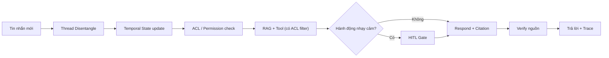
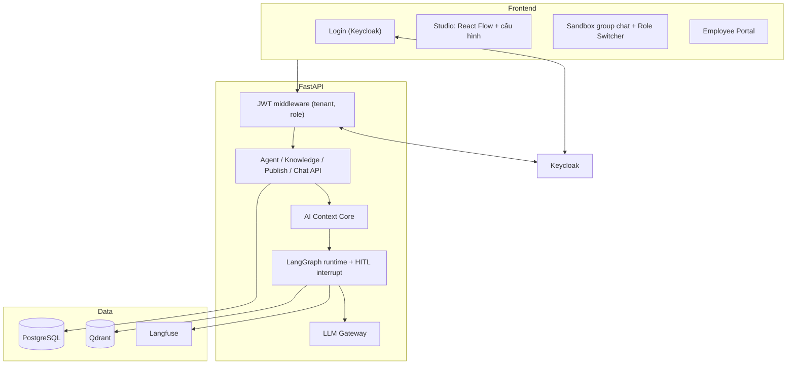

# PRD — Mini Agent Studio (CHAT-40)

> **Sản phẩm:** Mini Agent Studio — nền tảng No-Code tạo AI Agent đa lĩnh vực (Doanh nghiệp, Giáo dục, Y tế, Cộng đồng) với xử lý đan xen hội thoại & phân quyền theo đơn vị
> **Mã đề:** CHAT-40 | **Đội:** AI20K T057 | **Phiên bản tài liệu:** 1.2 | **Ngày:** 14/11/2026
> **Nguồn:** Đề bài CHAT-40, `Brief.md`, `README.md` và mã nguồn hiện tại trong repo (nhánh `main`).

---

## 1. Tóm tắt điều hành

Creator/Admin ở nhiều lĩnh vực khác nhau — từ **Doanh nghiệp** (chia theo Phòng ban: Marketing, Kế toán, Nhân sự, IT, Sales...), **Giáo dục / Trường học** (chia theo Khoa/Viện, Lớp học, Phòng Đào tạo...), đến **Y tế / Tổ chức cộng đồng** (chia theo Chuyên khoa, Ban chuyên môn) — đều có nhu cầu tạo AI Agent hỗ trợ quy trình, giải đáp tài liệu và xử lý yêu cầu nội bộ nhưng không có kỹ năng lập trình. Khi đưa bot vào môi trường chat thực tế của đơn vị, bot còn gặp ba vấn đề lớn:

1. Nhiều chủ đề đan xen cùng lúc trong cùng một nhóm trao đổi.
2. Tin nhắn sau có thể phủ định hoặc sửa quyết định ở tin nhắn trước.
3. Dữ liệu nội bộ giữa các đơn vị (phòng ban / lớp học / chuyên khoa) dễ bị truy cập chéo vượt quyền và hành động nhạy cảm dễ bị thực thi nhầm.

**Mini Agent Studio** gồm hai phần:

| Cấu phần | Mô tả |
|---|---|
| **No-Code Studio Đa Lĩnh Vực** | Creator chọn lĩnh vực (Doanh nghiệp / Giáo dục / Y tế / Tùy chỉnh), cấu hình instruction, kho tri thức (knowledge), tools và workflow 3–5 node theo từng **Đơn vị (Phòng ban / Lớp học / Khoa)**. Creator test trong Sandbox rồi publish, có versioning và trace. |
| **AI Context Core** | Engine cho hội thoại nhóm: tách luồng hội thoại, theo dõi trạng thái quyết định theo thời gian, truy xuất có kiểm soát quyền theo đơn vị (Unit ACL), bắt buộc trích dẫn nguồn và xác nhận của người dùng (HITL) với hành động nhạy cảm. |

**Tuyên bố giá trị:** Một Creator không biết code ở bất kỳ ngành nghề nào có thể tạo, phân quyền theo đơn vị (phòng ban / lớp học / khoa), test và publish một Agent chuyên trách trong vòng **≤ 15 phút**. Agent đó không rò rỉ dữ liệu sang đơn vị khác, mọi câu trả lời đều truy ngược được về tin nhắn hoặc tài liệu nguồn, và có số liệu định lượng chứng minh chất lượng.

---

## 2. Mục tiêu & Phi mục tiêu

### 2.1 Mục tiêu

| # | Mục tiêu | Chỉ số thành công (đề xuất) |
|---|---|---|
| G1 | Creator tạo Agent không cần code | Thời gian từ lúc tạo đến lúc publish (agent đầu tiên) ≤ 15 phút. Tỷ lệ hoàn thành luồng trong user test ≥ 80%. |
| G2 | Agent chạy được trong group chat nhiều luồng | Thread disentanglement F1 ≥ 0.75 trên tập đánh giá (Ubuntu IRC + kịch bản tiếng Việt tự xây). |
| G3 | Không dùng thông tin đã bị ghi đè | Temporal state accuracy ≥ 90%. Stale-decision usage rate ≤ 5%. |
| G4 | Bảo mật dữ liệu tuyệt đối | **0** trường hợp rò rỉ vượt quyền trên bộ red-team ACL (≥ 50 case). |
| G5 | Mọi nội dung đều có nguồn | Citation coverage ≥ 95%. Citation precision ≥ 90%. |
| G6 | An toàn khi thực thi hành động | 100% hành động nhạy cảm đi qua HITL. **0** hành động chạy khi chưa có xác nhận. |
| G7 | Phản hồi đủ nhanh | p50 ≤ 3s, p95 ≤ 8s cho một lượt trả lời (không tính bước chờ HITL). |
| G8 | Truy vết đầy đủ | 100% lượt chạy có trace theo từng node, lưu input, output, latency, token và cost. |

### 2.2 Phi mục tiêu (MVP)

- Không xây no-code platform hoàn chỉnh. Workflow tối đa 3–5 node và vài tool.
- Không có marketplace Agent, billing hay thanh toán.
- Không tích hợp sâu với Zalo, Teams hay Slack. Sandbox mô phỏng group chat là đủ cho MVP.
- Không huấn luyện hay fine-tune mô hình. Chỉ dùng LLM qua Gateway.
- Không xử lý audio và video đầy đủ. Đa phương tiện chỉ ở mức ảnh/đính kèm có caption (xem mục 16).

---

## 3. Đối tượng người dùng & Phân quyền

### 3.1 Personas (Đa ngành nghề)

| Persona | Vai trò hệ thống | Lĩnh vực & Nhu cầu chính |
|---|---|---|
| **Linh — Quản trị viên Tổ chức** (Creator) | `TENANT_ADMIN` | Tạo bot chuyên trách cho từng **Phòng ban** (Doanh nghiệp: Marketing, Kế toán, HR, IT...) hoặc từng **Khoa / Lớp học** (Giáo dục: Lớp AI-K5, Khoa CNTT, Phòng Đào tạo...) mà không cần code. Kiểm soát đơn vị nào xem được tài liệu nào, duyệt yêu cầu HITL. |
| **Nam — Nhân viên Marketing / Sinh viên Lớp AI** | `EMPLOYEE` (Đơn vị A) | Hỏi nhanh quy chế, kế hoạch, tài liệu học tập/nghiệp vụ của đơn vị mình; gửi phiếu đề xuất / đơn học vụ cần duyệt ngay trong chat. |
| **Mai — Nhân viên Kế toán / Giảng viên Khoa Kinh tế** | `EMPLOYEE` (Đơn vị B) | Truy cập bot và kho tài liệu chuyên môn của đơn vị mình mà các phòng ban / lớp học khác không được phép xem. |
| **Platform Owner** | `SUPER_ADMIN` | Cấp tenant mới theo lĩnh vực (`ENTERPRISE`, `EDUCATION`, `HEALTHCARE`, `CUSTOM`), giám sát hệ thống, không đọc dữ liệu nghiệp vụ của tenant. |

> **Quyết định thiết kế:** Hệ thống dùng **3 role** (`SUPER_ADMIN`, `TENANT_ADMIN`, `EMPLOYEE` — đại diện cho Thành viên / Nhân sự / Sinh viên của tổ chức), khớp với Keycloak hiện có. Phân quyền dữ liệu dựa trên thuộc tính **Đơn vị (`department` / `unit_scope`)** linh hoạt theo ngành nghề: là *Phòng ban* đối với Doanh nghiệp, là *Khoa / Lớp học* đối với Trường học, hoặc *Chuyên khoa* đối với Y tế.

### 3.2 Ma trận quyền (RBAC)

| Chức năng | SUPER_ADMIN | TENANT_ADMIN | EMPLOYEE (Thành viên/NV/SV) |
|---|:-:|:-:|:-:|
| Tạo/xoá tenant (chọn lĩnh vực) | ✅ | ❌ | ❌ |
| Quản lý thành viên & gán Đơn vị (Phòng/Lớp/Khoa) | ❌ | ✅ | ❌ |
| Tạo/sửa Agent theo Đơn vị, workflow, permission manifest | ❌ | ✅ | ❌ |
| Upload knowledge và gán ACL theo Đơn vị | ❌ | ✅ | ❌ |
| Publish / rollback Agent | ❌ | ✅ | ❌ |
| Xem trace và eval dashboard | Metric tổng hợp | ✅ (tenant mình) | ❌ |
| Chat với Agent đã publish | ❌ | ✅ | ✅ (theo ACL Đơn vị: Phòng ban / Lớp học) |
| Xác nhận (HITL) hành động của chính mình | — | ✅ | ✅ |
| Duyệt hành động cần phê duyệt (approver) | — | ✅ | Nếu `is_approver = true` |

### 3.3 Thuộc tính người dùng dùng cho ACL

Ngoài `role`, mỗi user có các thuộc tính sau. Các thuộc tính này lấy từ JWT (Keycloak) và là đầu vào cho ACL ở tầng truy xuất và Permission Manifest:

| Thuộc tính | Ý nghĩa | Ví dụ (Doanh nghiệp / Giáo dục / Y tế) |
|---|---|---|
| `tenant_id` | Mã định danh tổ chức của user | `VINFAST`, `VINUNI`, `BACHMAI` |
| `domain_type` | Lĩnh vực hoạt động của tổ chức | `ENTERPRISE`, `EDUCATION`, `HEALTHCARE`, `CUSTOM` |
| `department` | Đơn vị trực thuộc (Phòng ban / Lớp học / Khoa), dùng để lọc tài liệu và Agent | Doanh nghiệp: `Marketing`, `Accounting`, `HR`, `IT`<br>Giáo dục: `Lop_AI_K5`, `Khoa_CNTT`, `Phong_Dao_Tao`<br>Y tế: `Khoa_Noi`, `Khoa_Duoc` |
| `is_approver` | Có quyền duyệt hành động HITL của người khác | `true` với Trưởng phòng / Chủ nhiệm khoa / Giáo vụ |
| `clearance_level` *(tuỳ chọn, P1)* | Mức truy cập dữ liệu chi tiết trong cùng đơn vị | `PUBLIC` / `INTERNAL` |

> **Cô lập tenant:** mọi truy vấn DB, vector và trace đều bắt buộc có `tenant_id` lấy từ **token đã xác thực**. Không nhận `tenant_id` từ client.

---

## 4. Hiện trạng (As-is) và khoảng cách (Gap)

Phần này dựa trên việc đọc mã nguồn hiện tại. PRD này là kế hoạch nâng từ bản demo lên MVP đúng đề bài.

### 4.1 Đã có

| Hạng mục | Hiện trạng | File |
|---|---|---|
| Multi-tenant | Bảng `tenants`, `users`, `agents`, `documents`, `leave_requests` (đang dùng làm bảng yêu cầu HITL chung). | `init_saas_db.py`, `server.py` |
| Vai trò | `SUPER_ADMIN` / `TENANT_ADMIN` / `EMPLOYEE`, đồng bộ role sang Keycloak. | `server.py`, `init_keycloak.py` |
| SSO | Keycloak OIDC (realm `mini-agent-platform`), login qua `keycloak-js`. Đăng nhập trực tiếp `/api/login` đã bị chặn. | `login.html` |
| Agent engine | Class `LangGraphAgent` tự viết. **Hiện chỉ còn 1 nhánh: RAG → sinh câu trả lời** (đã gỡ phân loại ý định theo từ khoá và nhánh phép năm ở commit `eaf74c8`). | `agent_engine.py` |
| Agent theo phòng ban | Studio có mẫu 1-click cho Marketing / Kế toán / HR / IT / Sales (điền tên, phòng ban, instruction). Trường `department_access` lưu trong bảng `agents`. | `admin_studio.html` |
| RAG | Embedding Gemini 3072 chiều, cosine similarity, lọc theo tenant, lưu `vector_index.json`. Upload `.pdf/.txt/.md`. | `vector_store.py` |
| HITL | Bảng duyệt + API `/api/leave_requests` (tạo, `PENDING`, duyệt/từ chối, thông báo polling) **vẫn còn**, nhưng **agent không còn kích hoạt** luồng này từ chat. | `server.py`, `admin_studio.html` |
| Studio UI | Tạo Agent, upload tài liệu, playground, quản lý nhân sự (CRUD, bulk import), hộp thư phê duyệt. | `admin_studio.html` |
| Email | Gửi thông tin đăng nhập cho user mới qua SMTP (cấu hình `.env`). | `mailer.py` |
| Schema-Driven UI | API `/api/tenants/ui_schema`, `/generate_schema` và `schema_engine.py` còn trong backend, **nhưng UI đã gỡ**. Không thuộc phạm vi đề bài → đề xuất xoá hoặc chuyển P2. | `schema_engine.py`, `server.py` |

### 4.2 Khoảng cách so với đề bài

| # | Yêu cầu đề bài | Hiện trạng | Mức độ |
|---|---|---|---|
| 1 | Workflow 3–5 node, kéo thả (React Flow) | Pipeline cố định trong code. Không có editor và không lưu `workflow_config`. | 🔴 Thiếu |
| 2 | ≥ 3 tools, permission manifest | **0 tool** được agent gọi (đã gỡ tool phép năm). Không có manifest. | 🔴 Thiếu |
| 3 | Sandbox test với role switcher | Có playground đơn giản, chưa có group chat giả lập hay chuyển vai trò. | 🟠 Một phần |
| 4 | Publish, versioning, rollback | `is_published` đặt cứng bằng 1. Không có version. | 🔴 Thiếu |
| 5 | Trace theo node, Langfuse | Dashboard hiển thị **số cứng** (0.38s, 98.4%…). Không có trace thật. | 🔴 Thiếu |
| 6 | Memory cơ bản | Không có lịch sử hội thoại hay memory. Bảng `chat_logs` có trong `models.py` nhưng chưa dùng. | 🔴 Thiếu |
| 7 | Thread disentanglement | Không có. | 🔴 Thiếu |
| 8 | Temporal state tracking | Không có. | 🔴 Thiếu |
| 9 | Truy vết về tin nhắn nguồn | Citation mới ở mức tên file và điểm cosine. Chưa có `message_id` hay đoạn trích. | 🟠 Một phần |
| 10 | ACL tại tầng truy xuất | Chỉ lọc theo `tenant`. Tham số `department_access` được truyền vào `vector_search` nhưng **chưa được dùng** để lọc. Chặn Agent theo phòng ban **chỉ ở giao diện** (`employee_portal.html`), `/api/chat` không kiểm tra. | 🔴 Lỗ hổng |
| 11 | Vector DB (Qdrant) | JSON file và cosine tự viết. Không scale. | 🟠 Thay thế |
| 12 | Intent routing | **Không còn** (đã gỡ). Cần làm lại bằng LLM router (mục 6.2). | 🔴 Thiếu |
| 15 | HITL kích hoạt từ hội thoại | API và hộp thư duyệt còn, nhưng agent không còn đưa ra yêu cầu HITL. | 🔴 Thiếu |
| 13 | Eval dataset và regression test | Không có. | 🔴 Thiếu |
| 14 | Conditional branch, template, AI sinh workflow | Không có (nâng cao). | ⚪ P1 |

### 4.3 Vấn đề bảo mật cần xử lý trước khi demo

| Vấn đề | Rủi ro | Hành động |
|---|---|---|
| API không kiểm tra token và vai trò (`/api/users`, `/api/all_data`, `/api/tenants`…) | Ai gọi API cũng đọc/ghi được dữ liệu mọi tenant. | Middleware xác thực JWT (Keycloak), rút `tenant_id` và `role` từ token. |
| `tenant_id` nhận từ query/body | Giả mạo tenant. | Lấy từ token. |
| Cột `hashed_password` lưu **mật khẩu thô** | Lộ mật khẩu. | Bỏ cột, Keycloak là nguồn credential duy nhất. |
| `mailer.py` ghi mật khẩu thô vào log | Lộ mật khẩu. | Không log secret. |
| Endpoint `/api/all_data` trả toàn DB | Rò rỉ dữ liệu toàn nền tảng. | Xoá hoặc chỉ cho SUPER_ADMIN, đã ẩn dữ liệu nhạy cảm. |
| CORS `*`, chat nhận `user_id` từ client | Mạo danh người dùng. | Siết CORS, lấy user từ token. |
| `/api/chat` tìm Agent theo `name` (không theo tenant) | Gọi nhầm Agent tenant khác. | Tra theo `agent_id` + `tenant_id`. |
| Xoá tenant xoá cứng, không chặn quyền | Mất dữ liệu. | Soft-delete, chỉ SUPER_ADMIN, có xác nhận. |
| API key và mật khẩu mặc định (`admin123`) | Lộ khoá. | Dùng biến môi trường, không commit mật khẩu mặc định. |

> [!IMPORTANT]
> Mục 4.3 là **điều kiện chặn (blocker)** của mục tiêu G4 ("0 rò rỉ") và phải xong trước khi chạy bộ đo ACL.

---

## 5. Phạm vi sản phẩm

### 5.1 Ưu tiên

- **P0 (MVP, bắt buộc):** nhóm "Cơ bản" trong đề bài.
- **P1 (nâng cao):** nhóm "Nâng cao" trong đề bài.

### 5.2 Luồng người dùng chính (E2E)

```mermaid
flowchart LR
    A["Creator đăng nhập (Keycloak SSO)"] --> B["Tạo Agent: instruction"]
    B --> C["Upload knowledge + gán ACL"]
    C --> D["Chọn tools + Permission Manifest"]
    D --> E["Dựng workflow 3-5 node (React Flow)"]
    E --> F["Sandbox: test với Role Switcher"]
    F -->|Đạt| G["Chạy eval/regression"]
    F -->|Chưa đạt| B
    G --> H["Publish → Version N"]
    H --> I["Nhân viên chat trong group"]
    I --> J["Trace + Dashboard"]
    J -->|Lỗi| K["Rollback → Version N-1"]
```



---

## 6. Yêu cầu chức năng

Mỗi yêu cầu có mã `FR-xx`, mức ưu tiên và tiêu chí nghiệm thu (AC).

### 6.1 Quản lý Agent & Cấu hình (Studio)

| ID | Yêu cầu | Ưu tiên | Tiêu chí nghiệm thu |
|---|---|:-:|---|
| FR-01 | Tạo, sửa, xoá Agent. Gồm tên, mô tả, instruction (system prompt), mô hình LLM, nhiệt độ. | P0 | Lưu và tải lại được cấu hình. Chỉ `TENANT_ADMIN` thao tác được. Agent nằm trong đúng tenant. |
| FR-02 | **Knowledge:** upload `.txt`, `.md`, `.pdf`. Hệ thống tách chunk, embed, lưu vào Vector DB. Mỗi tài liệu có metadata ACL theo **Đơn vị** (Phòng ban / Lớp học / Khoa và vai trò được phép). | P0 | Sau upload có trạng thái *indexed* và số chunk. Xoá tài liệu thì xoá cả vector. |
| FR-03 | **Memory cơ bản:** (a) lịch sử hội thoại gần nhất trong phiên (window N lượt), (b) ghi nhớ sự kiện theo từng user/nhóm (key-value) có thể xem và xoá. | P0 | Agent nhắc lại được thông tin ở lượt trước. User xoá memory thì Agent không còn dùng. |
| FR-04 | **Tool registry** với ≥ 3 tool mẫu đa ngành nghề (xem mục 6.3). | P0 | Creator bật/tắt tool cho từng Agent trong UI. |
| FR-05 | **Permission Manifest** cho mỗi Agent (xem mục 6.4). | P0 | Tool không khai báo trong manifest thì không bao giờ được gọi. |
| FR-06 | **Workflow Builder (React Flow)** 3–5 node, kéo thả, kết nối, cấu hình từng node. Lưu thành JSON (`workflow_config`). | P0 | Validate: có điểm vào, không vòng lặp vô hạn, 3 ≤ số node ≤ 5, mọi node có đầu ra hợp lệ. |
| FR-07 | **Sandbox:** màn hình chat giả lập group chat nhiều người. Có **Role & Unit Switcher** chuyển giữa các persona thuộc các Đơn vị khác nhau (ví dụ: Admin / Thành viên Đơn vị A như Phòng Marketing hoặc Lớp AI-K5 / Thành viên Đơn vị B như Phòng Kế toán hoặc Khoa Kinh tế) và hiển thị trace tương ứng từng lượt. | P0 | Đổi persona tức thì. Kết quả truy xuất/tool thay đổi đúng theo ACL: thành viên Đơn vị A bị chặn tài liệu Đơn vị B, thành viên Đơn vị B xem được, Admin xem toàn tenant. |
| FR-08 | **Publish** Agent thành một phiên bản bất biến. Chỉ publish khi workflow hợp lệ và đã chạy sandbox ít nhất 1 lần. | P0 | Sau publish, thành viên chat với version đã publish, không bị ảnh hưởng bởi bản đang sửa. |
| FR-09 | **Versioning:** mỗi lần publish tạo `version` mới (instruction + workflow + manifest + danh sách tài liệu). Có changelog và diff. | P0 | Xem được lịch sử và so sánh 2 phiên bản. |
| FR-10 | **Rollback** về phiên bản trước chỉ với một thao tác. | P1 | Rollback ≤ 5 giây. Hội thoại mới dùng version đã chọn. Có ghi audit log. |
| FR-11 | **Conditional branch:** node điều kiện (theo intent, vai trò, kết quả tool, điểm RAG). | P1 | Workflow có nhánh chạy đúng theo điều kiện. |
| FR-12 | **Template đa lĩnh vực tái sử dụng:**<br>• **Doanh nghiệp (theo Phòng ban):** Marketing, Kế toán, Nhân sự (HR), Kỹ thuật IT, Kinh doanh (Sales).<br>• **Giáo dục (theo Khoa/Lớp):** Trợ giảng Lớp học, Cố vấn Học vụ Khoa, Phòng Đào tạo, Thư viện & Giáo trình.<br>• **Y tế / Dịch vụ (theo Chuyên khoa):** Hướng dẫn Quy trình Khám, Tra cứu Chuyên môn, Hành chính.<br>• **Tùy chỉnh:** Cho phép Admin tự tạo tên Đơn vị / Lớp / Nhóm bất kỳ. | P0/P1 | Chọn lĩnh vực và tạo Agent từ template trong ≤ 3 click. |
| FR-13 | **AI sinh workflow từ mô tả tự nhiên.** Ví dụ: "Bot trợ giảng cho Lớp AI-K5 trả lời giáo trình và nhận đơn xin phúc khảo cần giảng viên duyệt". | P1 | Sinh JSON hợp lệ theo schema, tuân thủ giới hạn 3–5 node. Creator chỉnh sửa lại được. Tỷ lệ JSON hợp lệ ≥ 90%. |

### 6.2 Workflow — loại node (MVP)

| Node | Chức năng |
|---|---|
| **Intent / Router** | Phân loại ý định bằng LLM (thay cho từ khoá cứng), fallback sang luật. |
| **Retrieve (RAG)** | Truy xuất tài liệu có ACL filter theo Đơn vị (`department`), trả về chunk kèm `source_id`. |
| **Tool** | Gọi tool qua Permission Manifest. |
| **HITL Gate** | Tạm dừng, chờ xác nhận của người dùng hoặc approver. |
| **Respond** | Sinh câu trả lời có trích dẫn bắt buộc. |
| *(P1)* **Condition** | Rẽ nhánh. |

Với group chat, hai node tiền xử lý của AI Context Core (**Thread Disentangle** và **Temporal State**) được cấu hình dưới dạng "context step" bật/tắt trong Agent. Hai node này không tính vào giới hạn 3–5 node của Creator.

### 6.3 Tools đa ngành nghề (≥ 3, MCP-like)

Mỗi tool có `name`, `input_schema`, `output_schema`, `risk_level` (`read` | `write` | `sensitive`) và `required_roles`. Các tool được thiết kế tổng quát để dùng được cho mọi ngành nghề (Doanh nghiệp, Trường học, Y tế, Tổ chức):

| Tool | Mô tả (Đa lĩnh vực) | Rủi ro | HITL |
|---|---|:-:|:-:|
| `doc_lookup` | Tra cứu tài liệu / quy chế / giáo trình nội bộ theo phạm vi Đơn vị (Phòng ban / Lớp học / Khoa). | read | Không |
| `unit_directory_lookup` | Tra cứu thông tin danh bạ đơn vị, lịch trình, thông báo chung của Phòng ban / Lớp học. | read | Không |
| `approval_request_create` | Tạo phiếu yêu cầu / đề xuất cần phê duyệt (Doanh nghiệp: đề xuất mua sắm, tạm ứng, công tác; Giáo dục: đơn học vụ, đăng ký đề tài; Y tế: phiếu yêu cầu chuyên môn). | sensitive | **Có** (người tạo xác nhận, cấp quản lý duyệt) |
| `send_email` | Soạn và gửi email / thông báo nội bộ cho cá nhân hoặc đơn vị. | sensitive | **Có** |
| `calendar_event` | Đặt lịch họp phòng ban / lịch phụ đạo lớp học / lịch hẹn (mock hoặc Google Calendar). | write | Có |
| `task_create` | Tạo đầu việc (task) cho thành viên trong phòng ban / nhóm học tập từ cam kết trong chat. | write | Có |

MVP bắt buộc tối thiểu 3 tool: `doc_lookup`, `approval_request_create`, `send_email`. Các tool còn lại là tuỳ chọn.

### 6.4 Permission Manifest

Mỗi Agent có một manifest khai báo, ví dụ:

```json
{
  "agent_id": "hr-bot",
  "version": 3,
  "knowledge_scope": { "departments": ["HR", "ALL"], "min_role": "EMPLOYEE" },
  "tools": {
    "doc_lookup":              { "roles": ["EMPLOYEE", "TENANT_ADMIN"], "hitl": false },
    "approval_request_create": { "roles": ["EMPLOYEE"], "hitl": "requester+approver" },
    "send_email":              { "roles": ["TENANT_ADMIN"], "hitl": "requester" }
  },
  "data_access": { "pii": false, "cross_tenant": false },
  "limits": { "max_tool_calls_per_turn": 3, "max_tokens": 1500 }
}
```

**AC:** Manifest được kiểm tra **ở runtime tại bước gọi tool**, không chỉ ở UI. Gọi tool ngoài manifest thì bị chặn và ghi log `DENIED`.

### 6.5 Chat & Group Chat (Runtime)

| ID | Yêu cầu | Ưu tiên |
|---|---|:-:|
| FR-20 | Employee Portal: chat 1-1 và group chat với Agent đã publish. Agent chỉ phản hồi khi được @mention hoặc theo trigger đã cấu hình. | P0 |
| FR-21 | Mọi câu trả lời hiển thị **nguồn trích dẫn** có thể bấm: tin nhắn nguồn (`message_id`, người gửi, thời gian) hoặc tài liệu nguồn (tên file, đoạn, điểm). | P0 |
| FR-22 | Thông báo thời gian thực khi đơn/hành động được duyệt hoặc từ chối (hiện dùng polling). | P0 |
| FR-23 | Tóm tắt group chat theo từng chủ đề (thread), có liên kết ngược về tin nhắn. | P0 |
| FR-24 | Khi thiếu căn cứ, Agent phải trả lời "không đủ thông tin" thay vì suy đoán. | P0 |

---

## 7. AI Context Core — yêu cầu chi tiết

### 7.1 Thread Disentanglement (tách luồng hội thoại)

**Bài toán:** nhiều chủ đề đan xen trong cùng một dòng tin nhắn.

**Đầu vào:** danh sách tin nhắn `{message_id, sender, ts, text, reply_to?, mentions?, attachments?}`.

**Đầu ra:** `thread_id` cho mỗi tin nhắn, kèm nhãn và tóm tắt ngắn của từng thread.

**Phương pháp (kết hợp):**

1. Tín hiệu cấu trúc: `reply_to`, mention, khoảng thời gian, người tham gia.
2. Gom cụm ngữ nghĩa bằng embedding (tin nhắn mới gán vào thread gần nhất nếu `sim ≥ τ`, ngược lại mở thread mới).
3. LLM phân xử các ca mơ hồ (điểm cận ngưỡng).
4. Chuẩn hoá tiếng lóng và viết tắt qua từ điển thuật ngữ của tenant (sửa được trong Studio).

**AC:**
- Mỗi tin nhắn thuộc đúng 1 thread, có thể gán lại thủ công trong Sandbox.
- Đạt chỉ số ở mục 9 trên tập đánh giá.
- Độ trễ bước tách luồng p95 ≤ 1.5s cho cửa sổ 50 tin nhắn.

### 7.2 Temporal State Tracking (theo dõi trạng thái theo thời gian)

**Bài toán:** quyết định ở tin nhắn sau có thể thay đổi hoặc huỷ quyết định ở tin nhắn trước. Ví dụ: "họp thứ 3" rồi "dời qua thứ 5" rồi "thôi huỷ họp".

**Mô hình dữ liệu:** mỗi "mục trạng thái" (quyết định, cam kết, task, lịch) là một bản ghi có vòng đời:

```
StateItem { id, thread_id, type, subject, value,
            status: ACTIVE | OVERRIDDEN | CANCELLED | DONE,
            source_message_id, superseded_by?, valid_from, valid_to? }
```

**Quy tắc:**
- Với mỗi tin nhắn mới, trích xuất sự kiện (tạo, sửa, huỷ, hoàn thành) rồi đối chiếu với `StateItem` đang `ACTIVE` cùng `subject`.
- Khi có xung đột, đánh dấu mục cũ `OVERRIDDEN`, gắn `superseded_by` trỏ tới tin nhắn mới và giữ lại toàn bộ lịch sử (không xoá).
- Truy vấn "hiện tại" chỉ dùng mục `ACTIVE`. Truy vấn lịch sử trả về chuỗi thay đổi theo thời gian.

**AC:**
- Agent **không bao giờ** trích dẫn giá trị `OVERRIDDEN` như thể còn hiệu lực.
- Câu trả lời nêu được cả giá trị hiện tại và tin nhắn gây ra thay đổi.
- Người dùng sửa được trạng thái sai (HITL) và việc sửa được ghi log.

### 7.3 Citation Grounding (truy vết nguồn)

- Mọi câu trả lời, tóm tắt, cam kết công việc hoặc cảnh báo phải kèm `sources[]`:
  `{type: message|document, id, excerpt, sender?, ts?, score?}`.
- Bước kiểm chứng sau sinh (verify): mỗi nhận định phải được hậu thuẫn bởi ít nhất một nguồn trong ngữ cảnh. Nếu không, loại bỏ hoặc hạ thành "chưa xác minh".
- Nguồn ở dạng `document` chỉ được hiển thị nếu người hỏi có quyền xem tài liệu đó (ACL áp dụng cả cho trích dẫn).

### 7.4 Kết hợp suy luận ngữ cảnh và kiểm chứng bằng chứng

Trình tự cho mỗi lượt hỏi trong group:



---

## 8. Bảo mật & Phân quyền 3 tầng

| Tầng | Cơ chế | Yêu cầu | Kiểm thử |
|---|---|---|---|
| **1. Identity** | Keycloak OIDC SSO. Token JWT mang `role`, `tenant_id`, `department`. | Backend xác thực chữ ký và hạn token ở mọi API. Không tin dữ liệu từ client. | Gọi API không token, token sai tenant, token hết hạn thì bị từ chối (401/403). |
| **2. Retrieval (Vector DB)** | Lọc cứng bằng metadata filter (`tenant_id`, `department`, `min_role`, `doc_acl`) **ngay trong câu truy vấn Qdrant**. | LLM không bao giờ nhận được chunk vượt quyền. Filter áp dụng **trước** khi xếp hạng, không phải lọc sau. | Bộ red-team ≥ 50 câu hỏi cố gắng lấy tài liệu phòng khác. Kỳ vọng 0 rò rỉ. |
| **3. Execution & HITL** | Permission Manifest + LangGraph interrupt. | Tool ngoài manifest thì bị chặn. Tool `sensitive` thì tạm dừng chờ xác nhận. Xác nhận ghi lại ai, khi nào, nội dung gì. | 100% tool nhạy cảm tạo `PENDING`. Không có tác dụng phụ trước khi xác nhận. |

### 8.1 Yêu cầu HITL

- Trạng thái: `PENDING → CONFIRMED_BY_REQUESTER → APPROVED/REJECTED → EXECUTED/CANCELLED`.
- Giao diện xác nhận nêu rõ: tool nào, tham số gì, hậu quả gì.
- Có thời hạn hiệu lực (timeout) và có thể huỷ trước khi thực thi.
- Idempotent: duyệt hai lần không thực thi hai lần. Code hiện tại đã có chặn `old_status != 'APPROVED'`, cần giữ lại.
- Prompt injection: nội dung tin nhắn hoặc tài liệu **không được** thay đổi manifest hay bỏ qua HITL.

### 8.2 Audit & Privacy

- Audit log bất biến: đăng nhập, publish, rollback, thay đổi quyền, duyệt/từ chối HITL, truy cập bị chặn.
- Che dữ liệu nhạy cảm (PII) trong trace theo cấu hình.
- Cô lập tuyệt đối giữa các tenant (DB, vector, trace).

---

## 9. Đo lường & Đánh giá (Evaluation)

### 9.1 Bộ dữ liệu

| Năng lực | Dataset tham chiếu | Ghi chú |
|---|---|---|
| Thread disentanglement | **Ubuntu IRC Disentanglement** | Chuẩn quốc tế. Bổ sung kịch bản tiếng Việt tự xây. |
| Tóm tắt hội thoại | **SAMSum, DialogSum, MeetingBank** | Đo độ trung thực (faithfulness). |
| Tác vụ đa bước / tool | **MultiWOZ, τ-bench** | Task success rate. |
| Đa ngôn ngữ / tiếng Việt | **FLORES-200, PhoMT, VIVOS** | Kiểm tra chuẩn hoá tiếng lóng, viết tắt. |
| Cảnh báo lừa đảo | **PhishTank, ViHSD** | Kịch bản cảnh báo link/nội dung độc hại trong group. |
| Temporal & ACL | **Tự xây (≥ 100 kịch bản)** | Quyết định bị ghi đè nhiều lần. Red-team truy cập vượt quyền. |

### 9.2 Chỉ số và ngưỡng mục tiêu (đề xuất, cần xác nhận)

| Nhóm | Chỉ số | Mục tiêu MVP | Mục tiêu P1 |
|---|---|:-:|:-:|
| Tách luồng | Cluster F1 / VI score | ≥ 0.75 | ≥ 0.85 |
| Temporal | State accuracy | ≥ 90% | ≥ 95% |
| Temporal | Stale-decision usage | ≤ 5% | ≤ 2% |
| Trung thực | Faithfulness (LLM-judge + kiểm tra thủ công) | ≥ 0.85 | ≥ 0.92 |
| Trích dẫn | Citation precision / coverage | ≥ 90% / ≥ 95% | ≥ 95% / ≥ 98% |
| ACL | Số rò rỉ trên red-team | **0** | **0** |
| HITL | Hành động nhạy cảm bypass HITL | **0** | **0** |
| Workflow | JSON hợp lệ khi AI sinh workflow | — | ≥ 90% |
| Độ trễ | p50 / p95 một lượt | ≤ 3s / ≤ 8s | ≤ 2s / ≤ 5s |
| Chi phí | Token và chi phí mỗi lượt | Theo dõi | Có ngưỡng cảnh báo |

### 9.3 Pipeline

- **Eval dataset** quản lý trong Studio (hoặc repo `eval/`), có phiên bản.
- **Regression test:** tự chạy khi publish. Điểm rơi dưới ngưỡng thì chặn publish (hoặc cảnh báo bắt buộc xác nhận) và đề xuất rollback.
- **Langfuse:** gửi trace thật cho mỗi lượt (node, latency, token, cost) và điểm eval. Thay thế các số liệu cứng trên dashboard hiện tại.
- Báo cáo kỹ thuật định lượng xuất ra từ chính pipeline này (deliverable của đề bài).

---

## 10. Trace & Observability

| ID | Yêu cầu | Ưu tiên |
|---|---|:-:|
| FR-30 | Mỗi lượt chạy có `trace_id`, liệt kê node theo thứ tự với input, output, thời gian, token, trạng thái, lý do bị chặn (nếu có). | P0 |
| FR-31 | Trace hiển thị ngay trong Sandbox (bên cạnh chat) và trong trang Trace của Studio. | P0 |
| FR-32 | Tích hợp Langfuse (self-host hoặc cloud). Có liên kết từ Studio sang trace tương ứng. | P0 |
| FR-33 | Dashboard thực: số lượt, tỷ lệ thành công, latency p50/p95, chi phí, số lần bị ACL chặn, số HITL chờ. | P0 |

---

## 11. Kiến trúc kỹ thuật

### 11.1 Stack mục tiêu và lộ trình chuyển đổi

| Thành phần | Hiện tại | Mục tiêu MVP |
|---|---|---|
| Backend | `http.server` thuần (`server.py`) | **FastAPI** (REST + SSE/WebSocket) |
| Orchestration | Class `LangGraphAgent` tự viết, tuần tự | **LangGraph** thật (state graph, checkpoint, interrupt cho HITL) |
| LLM | Gọi trực tiếp Gemini | **LLM Gateway** (Gemini, Groq, Ollama) cấu hình bằng env, retry, timeout, fallback, đo token |
| Vector DB | `vector_index.json` + cosine tự viết | **Qdrant** với payload filter |
| Database | SQLite | **PostgreSQL** (SQLite giữ cho dev nhanh nếu cần) |
| Auth | Keycloak (đã có, chưa enforce ở backend) | Keycloak + middleware JWT |
| Workflow UI | Không có | **React Flow** |
| Observability | Số liệu cứng | **Langfuse** |
| Frontend | HTML tĩnh + Bootstrap | Giữ HTML cho các trang hiện có. Màn Builder và Sandbox dùng React. |

> **Gợi ý thực hiện:** làm theo hướng tăng dần. Dùng FastAPI bọc lại logic hiện có trước, sau đó thay từng phần (Qdrant, LangGraph, Langfuse). Mỗi bước phải chạy được demo.

### 11.2 Sơ đồ



### 11.3 Mô hình dữ liệu (mở rộng)

| Bảng | Trường chính |
|---|---|
| `tenants`, `users` | Giữ. Bỏ mật khẩu thô. `role` gồm `SUPER_ADMIN` / `TENANT_ADMIN` / `EMPLOYEE`. Thêm `is_approver` (và `clearance_level` nếu làm P1). |
| `agents` | `id, tenant_id, name, status (draft/published), current_version_id, created_by` |
| `agent_versions` | `id, agent_id, version, instruction, workflow_json, manifest_json, knowledge_ids, changelog, created_by, created_at` (bất biến) |
| `documents` | Thêm `acl_json` (departments, min_role), `status`, `chunk_count` |
| `tools`, `agent_tools` | Registry tool và cấu hình theo Agent |
| `conversations`, `messages` | `message_id, conversation_id, sender_id, text, reply_to, ts, thread_id` |
| `threads` | `thread_id, conversation_id, label, summary` |
| `state_items` | Như mục 7.2 |
| `memories` | `scope (user/group), key, value, source_message_id` |
| `hitl_requests` | `id, tool, params, requester, approver, status, timestamps` |
| `traces`, `trace_spans` | `trace_id, agent_version_id, node, input, output, latency_ms, tokens, status` |
| `eval_datasets`, `eval_cases`, `eval_runs` | Dataset, kịch bản, kết quả và điểm theo version |
| `audit_logs` | Hành động nhạy cảm, bất biến |

---

## 12. Yêu cầu phi chức năng

| Nhóm | Yêu cầu |
|---|---|
| Hiệu năng | p50 ≤ 3s, p95 ≤ 8s mỗi lượt. Hỗ trợ ≥ 20 người dùng đồng thời trong demo. |
| Độ tin cậy | LLM lỗi hoặc timeout thì có fallback model và thông báo lịch sự. Không làm sập luồng. |
| Bảo mật | Mục 4.3 và mục 8. Secret lấy từ biến môi trường, không commit khoá. |
| Khả năng quan sát | 100% lượt có trace. Log có `trace_id`. |
| Khả năng triển khai | Chạy bằng Docker Compose (FastAPI, Postgres, Qdrant, Keycloak, Langfuse) với một lệnh. Hướng dẫn cho macOS, Linux và Windows. |
| Khả năng mở rộng | Thêm tool mới bằng cách khai báo schema, không sửa lõi. Đổi LLM bằng cấu hình. |
| Ngôn ngữ | Giao diện và prompt tiếng Việt. Hỗ trợ tiếng Anh cho dữ liệu benchmark. |
| Khả dụng giao diện | Bố cục chia đôi (Studio ở trái, Sandbox ở phải), hoạt động trên desktop, hiển thị tốt trên tablet. |

---

## 13. Trải nghiệm người dùng (UX)

### 13.1 Màn hình

| Màn hình | Người dùng | Nội dung chính |
|---|---|---|
| Login | Tất cả | Đăng nhập Keycloak SSO. |
| Super Admin | SUPER_ADMIN | Quản lý tenant, tình trạng hệ thống. |
| **Studio (chia đôi)** | TENANT_ADMIN | **Trái:** React Flow (workflow), tab Instruction / Knowledge / Tools / Manifest / Memory. **Phải:** Sandbox group chat + Role Switcher + panel Trace. |
| Versions | TENANT_ADMIN | Lịch sử phiên bản, diff, rollback. |
| Eval & Trace | TENANT_ADMIN | Chạy eval/regression, điểm theo version, liên kết Langfuse. |
| Approvals | TENANT_ADMIN / approver | Hộp thư duyệt HITL. |
| Employee Portal | EMPLOYEE | Chat với Agent theo phòng ban, thông báo duyệt, xem nguồn trích dẫn. |

### 13.2 Nguyên tắc

- Mọi thao tác nhạy cảm đều có bước xác nhận rõ ràng, kèm tóm tắt hậu quả.
- Trích dẫn luôn nhìn thấy được và bấm để mở nguồn.
- Lỗi ACL hiển thị thân thiện ("Bạn không có quyền truy cập nội dung này") và không tiết lộ sự tồn tại hay nội dung tài liệu.
- Trạng thái hệ thống luôn rõ (đang tìm tài liệu, đang chờ xác nhận, đã thực thi).

---

## 14. Kế hoạch triển khai

| Giai đoạn | Nội dung | Kết quả cần có |
|---|---|---|
| **M0 — Củng cố nền tảng** | Xử lý mục 4.3: JWT middleware, lấy tenant/role từ token, bỏ mật khẩu thô, siết `/api/all_data` và CORS. Chuyển sang FastAPI. Dọn các file lặp trong `backend/app/`. | API không còn truy cập ẩn danh. |
| **M1 — Lõi Agent (P0)** | LangGraph thật, LLM Gateway, Qdrant với ACL filter, tool registry (≥ 3 tool), Permission Manifest, HITL interrupt, memory cơ bản. | Một Agent chạy E2E đúng ACL và HITL. |
| **M2 — Studio & vòng đời (P0)** | React Flow Builder (3–5 node), Sandbox chia đôi + Role Switcher, publish, versioning, trace Langfuse thật. | Creator tạo và publish Agent không cần code. |
| **M3 — Context Core (P0)** | Thread disentanglement, temporal state tracking, citation tới `message_id`, tóm tắt theo thread. | Demo group chat đan xen với quyết định bị ghi đè. |
| **M4 — Đánh giá (P0)** | Xây eval dataset, chạy benchmark, dashboard điểm, báo cáo định lượng (độ trung thực và độ trễ). | Báo cáo kỹ thuật định lượng. |
| **M5 — Nâng cao (P1)** | Conditional branch, template, regression gating, rollback, AI sinh workflow. | Bộ tính năng nâng cao. |
| **M6 — Đóng gói** | Docker Compose, README, wireframe, video demo, PRD cuối. | Bàn giao theo đề. |

---

## 15. Rủi ro & Giảm thiểu

| Rủi ro | Mức | Giảm thiểu |
|---|:-:|---|
| Phạm vi quá rộng so với thời gian | Cao | Khoá phạm vi P0 trước. Làm tăng dần. Có bản demo chạy được sau mỗi mốc. |
| Độ chính xác tách luồng và temporal state thấp | Cao | Kết hợp tín hiệu cấu trúc, embedding và LLM. Xây dataset sớm. Đo từ M3. |
| LLM bịa hoặc dùng thông tin cũ | Cao | Bắt buộc citation, bước verify, quy tắc "không đủ thông tin". |
| Rò rỉ dữ liệu giữa phòng ban hoặc tenant | Cao | Filter tại Qdrant, red-team tự động trong CI, token-derived tenant. |
| Prompt injection trong tin nhắn hoặc tài liệu | Trung bình | Tách ngữ cảnh khỏi chỉ dẫn hệ thống. Manifest thực thi ngoài LLM. Case red-team riêng. |
| Phụ thuộc API LLM (hạn mức, độ trễ) | Trung bình | LLM Gateway với Ollama/Groq khi dev, cache embedding, fallback. |
| Hạ tầng nặng (Keycloak, Qdrant, Langfuse, Postgres) | Trung bình | Docker Compose, hướng dẫn rõ, profile "lite" cho dev. |
| Dữ liệu benchmark tiếng Anh khác bối cảnh doanh nghiệp VN | Trung bình | Bổ sung bộ dữ liệu tự xây bằng tiếng Việt. Báo cáo rõ độ phủ. |

---

## 16. Câu hỏi mở

1. **Ngưỡng mục tiêu** ở mục 9.2 là đề xuất. Đội có muốn điều chỉnh theo yêu cầu của BTC không?
2. **Stack:** bắt buộc dùng đúng PostgreSQL và Qdrant ngay từ MVP, hay chấp nhận SQLite và JSON index cho bản nộp đầu?
3. **Group chat:** chỉ cần Sandbox giả lập, hay cần tích hợp một kênh chat thật (ví dụ Telegram)?
4. **Đa phương tiện:** mức tối thiểu chấp nhận được là ảnh và tệp đính kèm có caption. Có cần OCR hoặc speech-to-text (VIVOS) không?
5. **Intern:** đã quyết định không tạo role riêng (mục 3). Nếu BTC yêu cầu rõ phải có Intern, dùng `clearance_level` thay vì thêm role. Cần xác nhận lại với BTC.
6. **LLM khi nghiệm thu:** dùng API của BTC hay Gemini? Cần xác nhận để cấu hình Gateway.
7. **Pháp lý và dữ liệu:** các tài liệu VinFast/FPT/VNG trong `data/` là dữ liệu mẫu hay có nội dung thật? Cần ghi rõ để tránh vấn đề bản quyền.

---

## 17. Phụ lục — Truy vết yêu cầu đề bài

| Yêu cầu đề bài | Mục PRD | Ưu tiên |
|---|---|:-:|
| Web app ≥ 2 vai trò phân quyền | 3, 8 | P0 |
| Prompt/instruction | FR-01 | P0 |
| Upload knowledge | FR-02 | P0 |
| ≥ 3 tools | FR-04, 6.3 | P0 |
| Workflow 3–5 node | FR-06, 6.2 | P0 |
| Memory cơ bản | FR-03 | P0 |
| Permission manifest | FR-05, 6.4 | P0 |
| Sandbox test | FR-07 | P0 |
| Publish / Versioning | FR-08, FR-09 | P0 |
| Trace | FR-30 đến FR-33 | P0 |
| Truy vết về tin nhắn/tài liệu nguồn | FR-21, 7.3 | P0 |
| HITL | 6.3, 8.1 | P0 |
| Đo lường định lượng trên dữ liệu hội thoại thật | 9 | P0 |
| ACL tại tầng truy xuất | 8 (Tầng 2) | P0 |
| Conditional branch | FR-11 | P1 |
| Reusable templates | FR-12 | P1 |
| Eval dataset, regression testing | 9.3 | P1 |
| Rollback | FR-10 | P1 |
| AI sinh workflow từ mô tả | FR-13 | P1 |
| Thread disentanglement | 7.1 | P0/P1 |
| Temporal state tracking | 7.2 | P0/P1 |
| Đánh giá độ trung thực và độ trễ | 9.2 | P1 |
