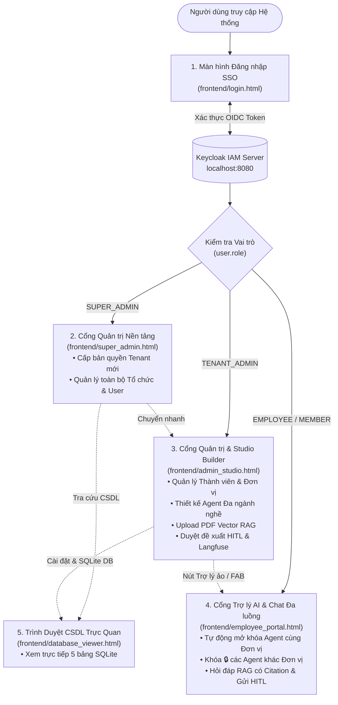
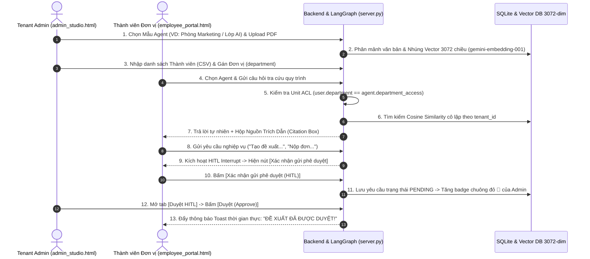

# WIREFRAME & UI FLOW — MINI AGENT STUDIO (CHAT-40)

* **Tên dự án:** Mini Agent Studio — Nền tảng No-Code khởi tạo AI Agent đa lĩnh vực & phân quyền theo đơn vị
* **Phong cách thiết kế (Design System):** Clean SaaS Dashboard (EduManage / OpenDesign Minimalist)
* **Bảng màu chủ đạo:** Nền sáng `#F8FAFC` / `#FFFFFF`, Xanh dương chủ đạo `#2563EB`, Sub-tab kích hoạt `#0F172A`, Trạng thái hoạt động `#DCFCE7` / `#16A34A`, Avatar định danh `#7C3AED` & `#DBEAFE`.

---

## 1. Sơ đồ Luồng Điều hướng Toàn Hệ thống (End-to-End UI Navigation Flow)

Hệ thống gồm **5 màn hình chính** trong thư mục `frontend/`, được phân luồng tự động dựa trên vai trò (`role`) và mã đơn vị (`department`) sau khi xác thực qua **Keycloak OIDC SSO**:



---

## 2. Sơ đồ Luồng Tương tác Nghiệp vụ & Phê duyệt HITL (User Interaction Flow)



---

## 3. Thiết kế Bố cục Wireframe Chi tiết Từng Màn hình

### 3.1. Màn hình 1: Cổng Đăng nhập SSO (`frontend/login.html`)
* **Mục đích:** Cổng xác thực tập trung tích hợp `keycloak-js` và danh sách tài khoản kiểm thử nhanh theo vai trò.

```text
+-----------------------------------------------------------------------------------+
|                                                                                   |
|                        +---------------------------------+                        |
|                        |           [ Logo M ]            |                        |
|                        |    Mini Agent Studio Platform   |                        |
|                        |   ( OIDC Single Sign-On Ready ) |                        |
|                        |                                 |                        |
|                        |  [ 🔐 Đăng nhập với Keycloak ]  |                        |
|                        |                                 |                        |
|                        |  --- Tài khoản Demo nhanh ---   |                        |
|                        |  • Super Admin: superadmin@...  |                        |
|                        |  • Tenant Admin: admin@...      |                        |
|                        |  • Thành viên: member@...       |                        |
|                        +---------------------------------+                        |
|                                                                                   |
+-----------------------------------------------------------------------------------+
```

---

### 3.2. Màn hình 2: Quản trị Tổ chức & No-Code Studio (`frontend/admin_studio.html`)
* **Mục đích:** Bố cục chuẩn **SaaS Dashboard** gồm Thanh Topbar, Menu dọc bên trái (Left Sidebar), Thẻ thông tin tổng quan, Thanh chuyển đổi Sub-tab ngang (nền đen `#0F172A` cho tab đang mở) và Khu vực làm việc chính.

#### **A. Chế độ Tab "Thành viên & Đơn vị" (`#tab-employees` - Mặc định)**
```text
+--------------------------------------------------------------------------------------------------+
| (M) MiniAgent Studio   [☰]                            VN  [🤖 Trợ lý ảo]  🔔(2)  (AD) Admin      |
|                                                                                   TENANT ADMIN   |
+------------------------+-------------------------------------------------------------------------+
| 📊 Tổng quan           | +---------------------------------------------------------------------+ |
| 👤 Quản lý Người dùng  | | Mã Tổ chức: VINFAST | Gói: ENTERPRISE | 4 Trợ lý AI | 12 Thành viên | |
| 🏢 Quản lý Tổ chức     | | Quản trị viên phụ trách: (A) Admin                                  | |
| 🛡️ Vai trò & Phân quyền| +---------------------------------------------------------------------+ |
| 📖 Tri thức & RAG      |                                                                         |
| ▌🗂️ Quản lý Phòng/Lớp  | [ Tổng quan ] [ ⬛ Thành viên & Đơn vị ] [ Thiết kế Agent ] [ Duyệt HITL]|
| 📅 Phê duyệt HITL      |                                                                         |
| 💬 Thống kê AI Chat    | +---------------------------------------------------------------------+ |
|                        | | Danh sách thành viên & Đơn vị                                       | |
|                        | | Phân quyền theo Phòng ban (Doanh nghiệp), Khoa/Lớp (Giáo dục)...    | |
|                        | |                                                                     | |
|                        | | [🔍 Tìm kiếm tên, email...] [Tất cả đơn vị v] [📄 CSV] [+ Thêm mới] | |
|                        | |---------------------------------------------------------------------| |
|                        | | Thành viên               | Đơn vị            | Trạng thái  | Thao tác| |
|                        | |--------------------------|-------------------|-------------|--------| |
|                        | | (N) Nam Anh              | Phòng Marketing   | [Đang hoạt  | [✏️][⋯]| |
|                        | |     namanh@gmail.com     |                   |  động] ✏️   |        | |
|                        | | (Q) Quang Trung          | Phòng Kế toán     | [Đang hoạt  | [✏️][⋯]| |
|                        | |     trung@gmail.com      |                   |  động] ✏️   |        | |
|------------------------| | (M) Minh Quân            | Lớp AI - K68      | [Đang hoạt  | [✏️][⋯]| |
| ⚙️ Cài đặt & SQLite DB | |     quan.nm@edu.vn       |                   |  động] ✏️   |        | |
| ↪️ Đăng xuất           | +---------------------------------------------------------------------+ |
|                        |                                                                    (✨) |
+------------------------+-------------------------------------------------------------------------+
```

#### **B. Chế độ Tab "Thiết kế Agent - Studio Builder" (`#tab-builder` - Split-Screen)**
```text
+------------------------+------------------------------------------------+------------------------+
| (Sidebar Điều hướng)   | CỘT TRÁI: CẤU HÌNH AGENT & RAG (8 CỘT)         | CỘT PHẢI: PLAYGROUND   |
|                        | +--------------------------------------------+ | +--------------------+ |
| 📊 Tổng quan           | | 1. Định Danh & Phân Quyền Đơn Vị (ACL)     | | | ⚡ Agent Playground | |
| 👤 Quản lý Người dùng  | | Chọn mẫu 1-Click: [🏢 DN] [🎓 GD] [🏥 Y tế]| | |--------------------| |
| ▌🏢 Quản lý Tổ chức    | | [🎯 Marketing] [💰 Kế toán] [👨‍🏫 Lớp AI]... | | | 🤖 Xin chào! Hãy   | |
| 🛡️ Vai trò & Phân quyền| | Tên Agent: [ Agent Phòng Marketing       ] | | | gõ câu hỏi để test | |
| 📖 Tri thức & RAG      | | Đơn vị ACL:[ Phòng Marketing / Tự nhập v ] | | | luồng RAG & Trace. | |
| 🗂️ Quản lý Phòng/Lớp   | | System Prompt: [ Bạn là trợ lý chuyên... ] | | |                    | |
| 📅 Phê duyệt HITL      | +--------------------------------------------+ | | [Trace Log]:       | |
| 💬 Thống kê AI Chat    | | 2. Nạp Tri Thức & Tài Liệu (Vector 3072d)  | | | ✓ Intent: RAG      | |
|                        | | [ Kéo thả file PDF / TXT vào đây (PDF.js) ]| | | ✓ Cosine: 0.84     | |
|                        | +--------------------------------------------+ | |--------------------| |
|                        | | 3. Sơ Đồ LangGraph  [☁️ Xuất Bản Agent]    | | | [Gõ thử...]  [▶]   | |
|                        | | [Start] -> [Intent] -> [RAG/HITL] -> [End] | | +--------------------+ |
+------------------------+------------------------------------------------+------------------------+
```

---

### 3.3. Màn hình 3: Cổng Trợ lý AI & Chat Đa luồng (`frontend/employee_portal.html`)
* **Mục đích:** Môi trường làm việc của Thành viên (Nhân viên / Sinh viên). Tự động mở khóa các Agent thuộc đơn vị của người dùng và khóa cứng (`🔒 Bị khóa`) các Agent của đơn vị khác.

```text
+--------------------------------------------------------------------------------------------------+
| (V) VINFAST Portal   [☰]                                  VN   [🤖 Trợ lý ảo]   (NA) Nam Anh     |
|     Tổ chức: VINFAST                                                                 MARKETING   |
+------------------------------+-------------------------------------------------------------------+
| +--------------------------+ | +---------------------------------------------------------------+ |
| | (N) Nam Anh              | | | 🤖 Agent Phòng Marketing                      [● Đang hoạt động]| |
| | Đơn vị: Marketing        | | |    Trợ lý chiến lược truyền thông & nội dung                  | |
| | [● Đang hoạt động]       | | +---------------------------------------------------------------+ |
| +--------------------------+ | |                                                               | |
|                              | | 👋 Xin chào Nam Anh! Bạn hãy đặt câu hỏi hoặc tạo đề xuất...  | |
| DANH MỤC TRỢ LÝ THEO ĐƠN VỊ: | |                                                               | |
| ▌✓ AI Policy Assistant       | |                                [ Tôi muốn tạo đề xuất duyệt   | |
| ▌  Phạm vi: ALL              | |                                  ngân sách chiến dịch TikTok ]| |
| ▌✓ Agent Phòng Marketing     | |                                                               | |
| ▌  Phạm vi: Marketing        | | 📝 [TRẠM KIỂM SOÁT CON NGƯỜI - HITL INTERRUPT]                | |
|                              | | • Người đề xuất: Nam Anh | Đơn vị: Marketing                  | |
| 🔒 Agent Phòng Kế Toán       | | • Nội dung: Duyệt ngân sách chiến dịch TikTok                 | |
|    Bị khóa (Chỉ Kế toán)     | | [ ✅ Xác nhận gửi phê duyệt (HITL) ]  [ Hủy bỏ ]              | |
| 🔒 Trợ Giảng Lớp AI - K68    | | ❝ Nguồn trích dẫn: LangGraph HITL Engine [Tập đoàn VinFast]   | |
|    Bị khóa (Chỉ Lớp AI)      | +---------------------------------------------------------------+ |
|------------------------------| | [📋 Kế hoạch đơn vị] [📖 Quy trình & Học vụ] [✍️ Tạo đề xuất] | |
| ⚙️ Làm mới | ↪️ Đăng xuất    | | [ Nhập câu hỏi hoặc yêu cầu phê duyệt...           ] [ Gửi ➤ ]| |
+------------------------------+-------------------------------------------------------------------+
```

---

### 3.4. Màn hình 4 & 5: Super Admin Control Plane (`super_admin.html`) & SQLite Explorer (`database_viewer.html`)
* **[super_admin.html](file:///D:/mini-agent-studio/frontend/super_admin.html):** Giao diện dành riêng cho `SUPER_ADMIN` để cấp bản quyền Tổ chức mới (chọn lĩnh vực Doanh nghiệp / Giáo dục / Y tế), xem thống kê số lượng Nhân sự & AI Bots của từng Tenant và quản trị toàn bộ tài khoản.
* **[database_viewer.html](file:///D:/mini-agent-studio/frontend/database_viewer.html):** Giao diện trực quan hóa trực tiếp 5 bảng dữ liệu (`tenants`, `users`, `documents`, `agents`, `leave_requests`) từ CSDL SQLite thời gian thực.
