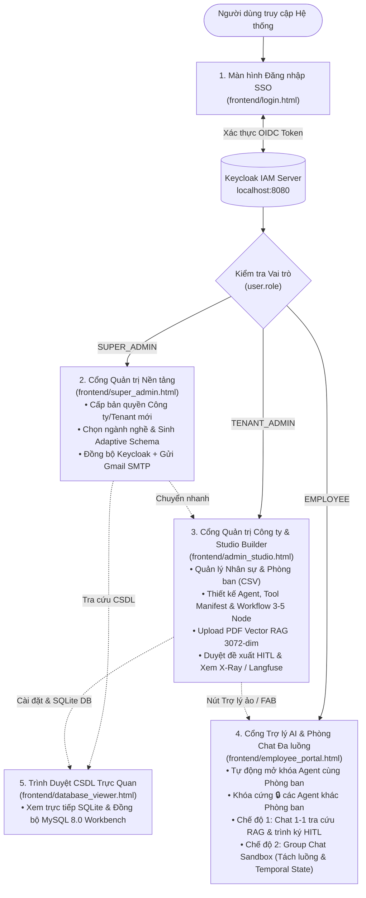
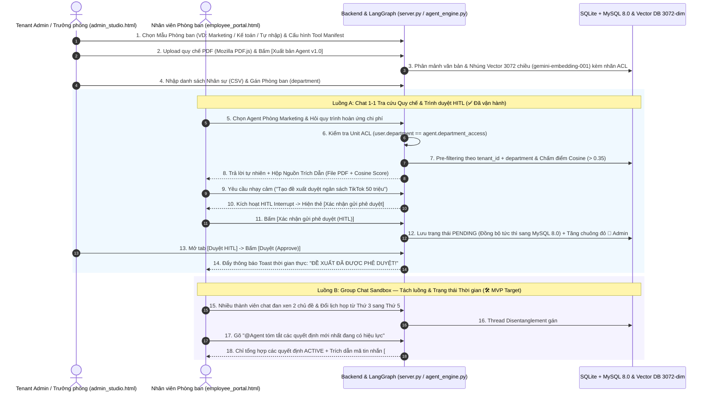

# WIREFRAME & UI FLOW — MINI AGENT STUDIO (CHAT-40)

* **Tên dự án:** Mini Agent Studio — Nền tảng No-Code khởi tạo AI Agent cho mọi Công ty & Tổ chức, xử lý đan xen hội thoại nhóm & phân quyền cô lập theo đơn vị
* **Định vị giao diện:** Thiết kế phục vụ **mọi loại hình công ty & doanh nghiệp** (`ENTERPRISE` làm kịch bản trọng tâm), đồng thời tự động biến đổi trường dữ liệu và biểu mẫu cho Giáo dục (`EDUCATION`), Y tế (`HEALTHCARE`) hoặc bất kỳ lĩnh vực công ty nào khác (`CUSTOM`) thông qua **Adaptive UI Schema Engine (`backend/schema_engine.py`)**.
* **Phong cách thiết kế (Design System):** Clean SaaS Dashboard (OpenDesign Minimalist / Shadcn-inspired)
* **Bảng màu chủ đạo:** Nền sáng `#F8FAFC` / `#FFFFFF`, Xanh dương chủ đạo `#2563EB`, Sub-tab kích hoạt `#0F172A`, Trạng thái hoạt động `ACTIVE` `#DCFCE7` / `#16A34A`, Cảnh báo `OVERRIDDEN` / `PENDING` `#FEF3C7` / `#D97706`, Avatar định danh `#7C3AED` & `#DBEAFE`.

---

## 1. Sơ đồ Luồng Điều hướng Toàn Hệ thống (End-to-End UI Navigation Flow)

Hệ thống gồm **5 màn hình chính** trong thư mục `frontend/`, được phân luồng tự động dựa trên vai trò (`role`), mã công ty (`tenant_id`) và mã đơn vị/phòng ban (`department`) sau khi xác thực qua **Keycloak OIDC SSO**:



---

## 2. Sơ đồ Luồng Tương tác Nghiệp vụ, Group Chat Context & Phê duyệt HITL



---

## 3. Thiết kế Bố cục Wireframe Chi tiết Từng Màn hình

### 3.1. Màn hình 1: Cổng Đăng nhập SSO Tập trung (`./frontend/login.html`)
* **Mục đích:** Cổng xác thực tập trung cấp độ Enterprise tích hợp `keycloak-js` (Realm `mini-agent-platform`, cổng `8080`). Sau khi đăng nhập thành công, hệ thống tự động nhận diện công ty (`tenant_id`), vai trò (`role`) và phòng ban (`department`).

```text
+-----------------------------------------------------------------------------------+
|                                                                                   |
|                        +---------------------------------+                        |
|                        |           [ Logo 🛡️ ]           |                        |
|                        |       OpenDesign Platform       |                        |
|                        |  ( ● Keycloak OIDC / OAuth2 )   |                        |
|                        |                                 |                        |
|                        |  [ 🔐 Đăng nhập bằng Keycloak ] |                        |
|                        |                                 |                        |
|                        |  Realm: mini-agent-platform     |                        |
|                        |  Port: 8080                     |                        |
|                        +---------------------------------+                        |
|                                                                                   |
+-----------------------------------------------------------------------------------+
```

---

### 3.2. Màn hình 2: Quản trị Công ty & No-Code Studio (`./frontend/admin_studio.html`)
* **Mục đích:** Bố cục chuẩn **SaaS Dashboard** dành cho Quản trị viên Công ty / Trưởng bộ phận (`TENANT_ADMIN`), gồm Thanh Topbar, Menu dọc bên trái (Left Sidebar), Thẻ thông tin tổng quan tổ chức, Thanh chuyển đổi Sub-tab ngang (nền đen `#0F172A` cho tab đang mở) và Khu vực làm việc chính.

#### **A. Chế độ Tab "Thành viên & Đơn vị" (`#tab-employees` - Mặc định)**
> Tự động hiển thị nhãn cột và trường thông tin theo `ui_schema` của công ty (Mặc định: **Nhân sự & Phòng ban** cho mọi Doanh nghiệp; tự động chuyển thành **Khoa/Lớp** hoặc **Chuyên khoa** nếu công ty thuộc khối Giáo dục/Y tế).

```text
+--------------------------------------------------------------------------------------------------+
| (M) MiniAgent Studio   [☰]                            VN  [🤖 Trợ lý ảo]  🔔(2)  (AD) Admin      |
|                                                                                   TENANT ADMIN   |
+------------------------+-------------------------------------------------------------------------+
| 📊 Tổng quan           | +---------------------------------------------------------------------+ |
| 👤 Quản lý Người dùng  | | Mã Công ty: VINFAST | Mô hình: ENTERPRISE | 4 Agent | 12 Nhân viên  | |
| 🏢 Quản lý Tổ chức     | | Quản trị viên phụ trách: (A) Admin | Đồng bộ: SQLite ⇄ MySQL 8.0   | |
| 🛡️ Vai trò & Phân quyền| +---------------------------------------------------------------------+ |
| 📖 Tri thức & RAG      |                                                                         |
| ▌🗂️ Quản lý Phòng/Đơnvị| [ Tổng quan ] [ ⬛ Thành viên & Đơn vị ] [ Thiết kế Agent ] [ Duyệt HITL]|
| 📅 Phê duyệt HITL      |                                                                         |
| 💬 Thống kê AI Chat    | +---------------------------------------------------------------------+ |
|                        | | Danh sách Thành viên & Phân quyền theo Đơn vị (Unit ACL)            | |
|                        | | Áp dụng cho mọi Phòng ban Công ty (và mở rộng Khoa/Lớp/Chuyên khoa) | |
|                        | |                                                                     | |
|                        | | [🔍 Tìm kiếm tên, email...] [Tất cả đơn vị v] [📄 CSV] [+ Thêm mới] | |
|                        | |---------------------------------------------------------------------| |
|                        | | Thành viên               | Đơn vị / Phòng ban| Trạng thái  |Thao tác| |
|                        | |--------------------------|-------------------|-------------|--------| |
|                        | | (N) Nam Anh              | Phòng Marketing   | [Đang hoạt  | [✏️][⋯]| |
|                        | |     namanh@gmail.com     |                   |  động] ✏️   |        | |
|                        | | (Q) Quang Trung          | Phòng Kế toán     | [Đang hoạt  | [✏️][⋯]| |
|                        | |     trung@gmail.com      |                   |  động] ✏️   |        | |
|------------------------| | (H) Hoàng Lan            | Phòng Nhân sự (HR)| [Đang hoạt  | [✏️][⋯]| |
| ⚙️ Cài đặt & SQLite DB | |     lan.hr@company.vn    |                   |  động] ✏️   |        | |
| ↪️ Đăng xuất           | +---------------------------------------------------------------------+ |
|                        |                                                                    (✨) |
+------------------------+-------------------------------------------------------------------------+
```

#### **B. Chế độ Tab "Thiết kế Agent - Studio Builder" (`#tab-builder` - Split-Screen)**
> Tích hợp trọn vẹn cấu hình Định danh & Đơn vị ACL, Kho tri thức PDF Vector 3.072 chiều, Bộ công cụ MCP-like kèm Permission Manifest, Đồ thị luồng 3–5 Node (React Flow), Phiên bản phát hành (`v1.0`) và Cửa sổ Kiểm thử Live Playground kèm X-Ray Telemetry Trace.

```text
+------------------------+------------------------------------------------+------------------------+
| (Sidebar Điều hướng)   | CỘT TRÁI: CẤU HÌNH AGENT, TOOL & WORKFLOW (8)  | CỘT PHẢI: PLAYGROUND   |
|                        | +--------------------------------------------+ | +--------------------+ |
| 📊 Tổng quan           | | 1. Định Danh, Mẫu Ngành & Đơn Vị ACL       | | | ⚡ Agent Playground | |
| 👤 Quản lý Người dùng  | | Chọn nhanh: [🏢 Doanh nghiệp (Chính)]      | | | Phiên bản: [v1.0 ●]| |
| ▌🏢 Quản lý Tổ chức    | |             [🎓 Giáo dục] [🏥 Y tế] [+Khác]| | |--------------------| |
| 🛡️ Vai trò & Phân quyền| | Mẫu phòng: [🎯 Marketing][💰 Kế toán][👥HR]| | | 👤 Hỏi định mức    | |
| 📖 Tri thức & RAG      | | Tên Agent: [ Agent Phòng Marketing       ] | | | chi phí quảng cáo? | |
| 🗂️ Quản lý Phòng/Đơnvị | | Đơn vị ACL:[ Phòng Marketing / Tự nhập v ] | | | 🤖 Theo Điều 4 Quy | |
| 📅 Phê duyệt HITL      | | System Prompt: [ Bạn là trợ lý chuyên... ] | | | chế Marketing...   | |
| 💬 Thống kê AI Chat    | +--------------------------------------------+ | | ❝ [Quy_che_MKT.pdf | |
|                        | | 2. Kho Tri Thức RAG (Vector 3072d - PDF.js)| | |    Cosine: 0.84]   | |
|                        | | [ 📄 Kéo thả file PDF / TXT quy chế đơn vị]| | |--------------------| |
|                        | +--------------------------------------------+ | | 🔍 X-Ray Trace Log:| |
|                        | | 3. Công Cụ (MCP Tools) & Permission Manifest| | | • ACL: PASS (MKT)  | |
|                        | | [x] leave_balance        (🟢 Auto / Read)  | | | • Intent: RAG_SRCH | |
|                        | | [x] leave_request_create (🟠 Require HITL) | | | • Thread: #thr_01  | |
|                        | | [x] send_email           (🟠 Require HITL) | | | • State: 2 ACTIVE  | |
|                        | +--------------------------------------------+ | | • Latency: 1,120ms | |
|                        | | 4. Sơ Đồ Luồng Thực Thi (React Flow 5 Node)| | | • Tokens: ~340 tok | |
|                        | | [Guard]->[Disentangle]->[RAG/Tool]->[HITL] | | |--------------------| |
|                        | | Phiên bản: v1.0     [☁️ Xuất Bản Agent]    | | | [Gõ thử...]  [▶]   | |
+------------------------+------------------------------------------------+------------------------+
```

---

### 3.3. Màn hình 3: Cổng Trợ lý AI & Phòng Chat Đa luồng (`./frontend/employee_portal.html`)
* **Mục đích:** Không gian làm việc hằng ngày của Nhân viên / Thành viên đơn vị (`EMPLOYEE`). Hệ thống tự động mở khóa (`✓`) các Agent thuộc đúng phòng ban của người dùng (cùng Agent `ALL` toàn công ty) và khóa cứng (`🔒 Bị khóa`) toàn bộ Agent của các phòng ban khác. Hỗ trợ chuyển đổi mượt mà giữa **Chế độ Chat 1-1** và **Chế độ Chat Nhóm Phòng ban (Group Chat Sandbox)**.

#### **A. Chế độ 1: Chat 1-1 với Agent Phòng ban & Trạm Kiểm soát HITL (`✅ Đã vận hành`)**
```text
+--------------------------------------------------------------------------------------------------+
| (V) COMPANY Portal   [☰]              [💬 Chat 1-1 (Đang chọn)] [👥 Group Chat Phòng ban] (NA)   |
|     Công ty: VINFAST                                                       Đơn vị: MARKETING     |
+------------------------------+-------------------------------------------------------------------+
| +--------------------------+ | +---------------------------------------------------------------+ |
| | (N) Nam Anh              | | | 🤖 Agent Phòng Marketing                [v1.0 ● Đang hoạt động]| |
| | Đơn vị: Phòng Marketing  | | |    Trợ lý chiến lược truyền thông, ngân sách & nội dung       | |
| | [● Đang hoạt động]       | | +---------------------------------------------------------------+ |
| +--------------------------+ | |                                                               | |
|                              | | 👋 Xin chào Nam Anh! Bạn cần tra cứu quy chế hay tạo đề xuất? | |
| DANH MỤC TRỢ LÝ THEO ĐƠN VỊ: | |                                                               | |
| ▌✓ AI Policy Assistant       | |                                [ Tôi muốn tạo đề xuất duyệt   | |
| ▌  Phạm vi: Toàn công ty(ALL)| |                                  ngân sách chiến dịch TikTok ]| |
| ▌✓ Agent Phòng Marketing     | |                                                               | |
| ▌  Phạm vi: Phòng Marketing  | | 📝 [TRẠM KIỂM SOÁT CON NGƯỜI - HITL INTERRUPT]                | |
|                              | | • Người đề xuất: Nam Anh | Đơn vị: Phòng Marketing            | |
| 🔒 Agent Phòng Kế Toán       | | • Công cụ kích hoạt: leave_request_create (Require HITL)      | |
|    Bị khóa (Chỉ Kế toán)     | | • Nội dung: Duyệt ngân sách chiến dịch TikTok (50.000.000đ)   | |
| 🔒 Agent Phòng Nhân Sự (HR)  | | [ ✅ Xác nhận gửi Trưởng phòng duyệt (HITL) ]   [ Hủy bỏ ]    | |
|    Bị khóa (Chỉ Phòng HR)    | | ❝ Nguồn trích dẫn: LangGraph HITL Engine [Tập đoàn VinFast]   | |
|------------------------------| +---------------------------------------------------------------+ |
| ⚙️ Làm mới | ↪️ Đăng xuất    | | [📋 Kế hoạch đơn vị] [📖 Quy chế phòng ban] [✍️ Tạo đề xuất]  | |
|                              | | [ Nhập câu hỏi hoặc yêu cầu phê duyệt...           ] [ Gửi ➤ ]| |
+------------------------------+-------------------------------------------------------------------+
```

#### **B. Chế độ 2: Phòng Chat Nhóm Đa Thành viên — Tách Luồng & Trạng thái Thời gian (`🛠 MVP Target`)**
> Cho phép nhiều thành viên cùng phòng ban thảo luận đan xen (hoặc dùng thanh **Role Switcher** để giả lập nhiều nhân viên nói chuyện xen kẽ khi kiểm thử). Hệ thống tự động gắn nhãn luồng (`[Thread #1]`, `[Thread #2]`), đánh dấu các quyết định cũ bị ghi đè (`[OVERRIDDEN]`) và trích dẫn chính xác cả mã tin nhắn (`#msg_id`) lẫn tài liệu PDF.

```text
+--------------------------------------------------------------------------------------------------+
| (V) COMPANY Portal   [☰]              [💬 Chat 1-1] [⬛ 👥 Group Chat Phòng ban (Sandbox)] (NA)  |
|     Kênh nhóm: #phong-marketing-chung                                      Đơn vị: MARKETING     |
+------------------------------+-------------------------------------------------------------------+
| THÀNH VIÊN TRONG PHÒNG NHÓM: | +---------------------------------------------------------------+ |
| • (N) Nam Anh (Content)      | | 🎭 Thanh Giả lập Vai trò (Role Switcher):                     | |
| • (L) Lan Hương (Event)      | | Đang gửi tin nhắn với tư cách: [ (N) Nam Anh - Marketing v ]  | |
| • (M) Minh Tuấn (Leader)     | +---------------------------------------------------------------+ |
| • (🤖) @Agent Phòng Marketing| | [#msg_101] (N) Nam Anh (09:00)  [🏷️ Thread #1: Ngân sách Q2]  | |
|                              | | Mình dự kiến xin tạm ứng 40 triệu cho sự kiện ra mắt tuần tới.| |
| BẢNG TRẠNG THÁI QUYẾT ĐỊNH   | |                                                               | |
| THEO THỜI GIAN (TEMPORAL):   | | [#msg_102] (L) Lan Hương (09:02) [🏷️ Thread #2: Lịch họp]     | |
| +--------------------------+ | | ⚠️ [OVERRIDDEN bởi #msg_104] Chốt họp duyệt kịch bản lúc      | |
| | 📌 Lịch họp kịch bản:    | | | ~14:00 chiều Thứ Ba tại phòng họp A nhé mọi người.~           | |
| | • 14h Thứ Ba (#msg_102)  | | |                                                               | |
| |   Trạng thái: OVERRIDDEN | | | [#msg_103] (N) Nam Anh (09:04)  [🏷️ Thread #1: Ngân sách Q2]  | |
| | • 09h Thứ Năm (#msg_104) | | | Khoản 40 triệu này cần những giấy tờ gì để Kế toán giải ngân? | |
| |   Trạng thái: 🟢 ACTIVE  | | |                                                               | |
| |--------------------------| | | [#msg_104] (M) Minh Tuấn - Leader (09:05) [🏷️ Thread #2]      | |
| | 📌 Tạm ứng sự kiện:      | | | 🟢 [ACTIVE - Ghi đè #msg_102] Thứ Ba anh bận họp Ban Giám đốc | |
| | • 40 triệu (#msg_101)    | | | rồi, dời lịch họp duyệt kịch bản sang 09:00 sáng Thứ Năm nhé! | |
| |   Trạng thái: 🟢 ACTIVE  | | |                                                               | |
| +--------------------------+ | | [#msg_105] (N) Nam Anh (09:07): @Agent tóm tắt giúp các quyết | |
|                              | | định đang có hiệu lực và trả lời câu hỏi ở #msg_103 giúp mình!| |
| BỘ LỌC HIỂN THỊ LUỒNG:       | |---------------------------------------------------------------| |
| [● Tất cả luồng (2)       ]  | | 🤖 Agent Phòng Marketing (09:07):                             | |
| [○ Thread #1: Ngân sách Q2]  | | 1. Tổng hợp theo luồng (Chỉ lấy trạng thái ACTIVE):           | |
| [○ Thread #2: Lịch họp    ]  | |  • [Thread #2 - Lịch họp]: Đã chốt dời sang 09:00 sáng Thứ Năm| |
|                              | |    (theo quyết định mới nhất tại [#msg_104], đã bỏ qua lịch   | |
|                              | |    cũ 14:00 Thứ Ba tại [#msg_102 - OVERRIDDEN]).              | |
|                              | |  • [Thread #1 - Ngân sách]: Đề xuất tạm ứng 40 triệu ([#msg_101| |
|                              | |    - ACTIVE]). Theo quy chế, tạm ứng trên 30 triệu cần Tờ     | |
|                              | |    trình phê duyệt của Trưởng bộ phận và Báo giá nhà cung cấp.| |
|                              | | ❝ Nguồn trích dẫn 2 chiều (Dual Citation Grounding):          | |
|                              | |   • Tin nhắn nhóm: [#msg_104 - Minh Tuấn], [#msg_101 - Nam Anh]| |
|                              | |   • Tài liệu RAG: [Quy_che_Tai_chinh_Marketing.pdf | Sim:0.86]| |
|------------------------------| +---------------------------------------------------------------+ |
| ⚙️ Làm mới | ↪️ Đăng xuất    | | [Trả lời #msg_...] [Gõ tin nhắn hoặc @Agent...       ] [Gửi ➤]| |
+------------------------------+-------------------------------------------------------------------+
```

---

### 3.4. Màn hình 4 & 5: Super Admin Control Plane (`./frontend/super_admin.html`) & Visual Database Explorer (`./frontend/database_viewer.html`)

* **[super_admin.html](./frontend/super_admin.html):** Giao diện dành riêng cho Chủ nền tảng (`SUPER_ADMIN`) để cấp bản quyền Công ty/Tổ chức mới (`Tenant Provisioning`):
  - Hỗ trợ chọn nhanh các preset ngành nghề (**Doanh nghiệp `ENTERPRISE`**, **Giáo dục `EDUCATION`**, **Y tế `HEALTHCARE`**) hoặc chọn **Ngành nghề Tùy chỉnh (`CUSTOM`)** để AI tự động sinh cấu trúc trường dữ liệu (`ui_schema`) cho bất kỳ loại hình công ty nào (Ngân hàng, Bán lẻ, Logistics, Luật, Bất động sản...).
  - Tự động khởi tạo tài khoản `TENANT_ADMIN` trên **Keycloak OIDC SSO** và gửi mật khẩu bàn giao tới địa chỉ email thật qua **Google Gmail SMTP**.
* **[database_viewer.html](./frontend/database_viewer.html):** Giao diện trực quan hóa trực tiếp các bảng dữ liệu (`tenants`, `users`, `documents`, `agents`, `leave_requests`) từ CSDL `SQLite 3` nội bộ, đồng thời đối chiếu thời gian thực với máy chủ **MySQL 8.0 (`mini_agent_studio`)** trên **MySQL Workbench 8.0 CE**.
